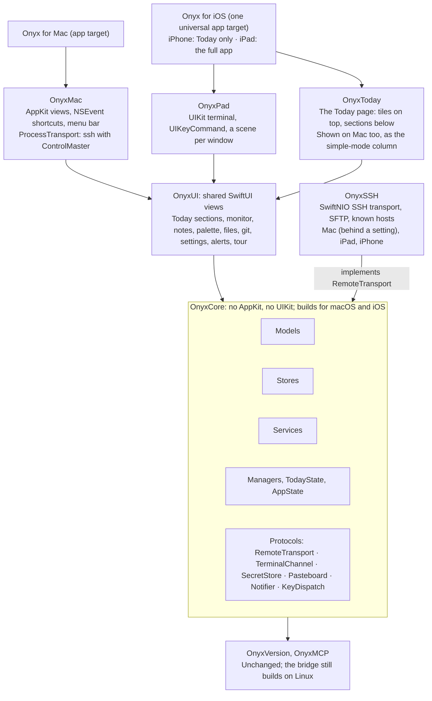
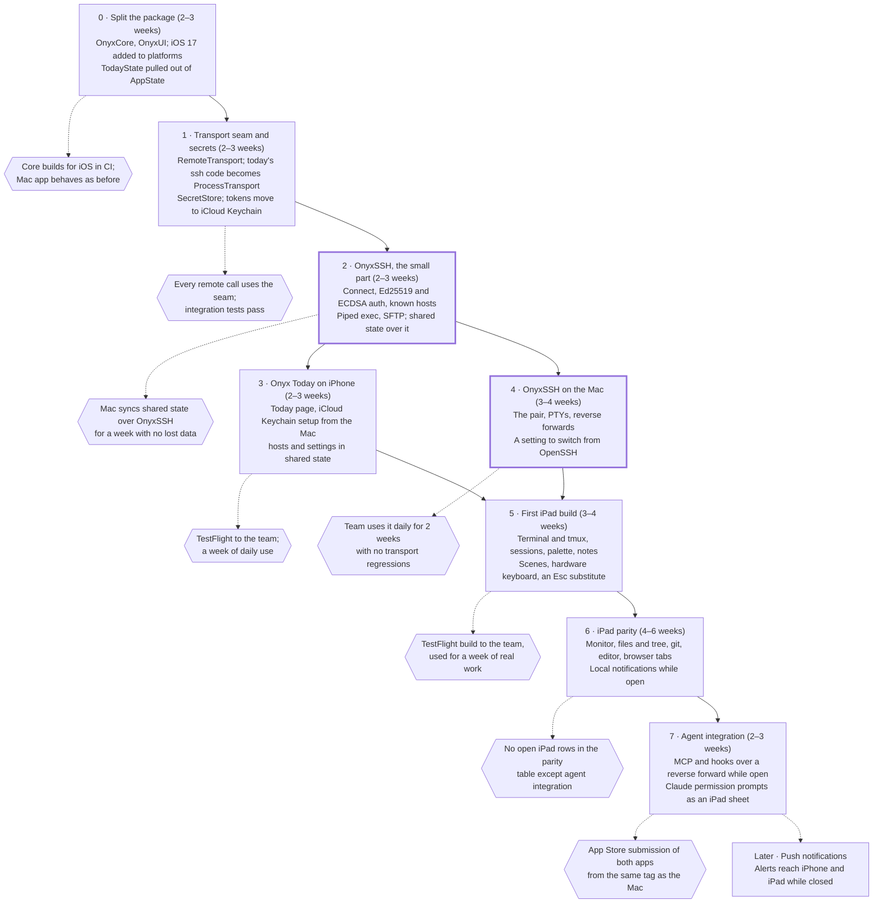

# Onyx on iPad and iPhone — plan

As of 2026-10-26 (first written 2026-10-23 as the iPad plan). Estimates are approximate and assume one engineer working with agents.

## Progress

| Phase | State |
| --- | --- |
| 0 · Split the package | Done: OnyxCore, OnyxUI; `TodayState` |
| 1 · Transport seam and secrets | Done: `RemoteTransport`, `SecretStore` |
| 2 · OnyxSSH, the small part | Done: connect, Ed25519/ECDSA, known hosts, exec, SFTP; shared state can ride it |
| 3 · Onyx Today on iPhone | Built and run in the simulator; needs signing, TestFlight and a device (docs/ios-today.md) |
| 4 · OnyxSSH on the Mac | Done behind Settings → Hosts → SSH client, except the Mac's terminals, which stay OpenSSH. No standby connection: one connection per host, replaced once, with a keepalive |
| 5 · First iPad build | Built and run in the simulator: hosts and routes from the shared state, tmux sessions, terminals, tabs per window, ⌘K, notes, ⌘. for Esc |
| 6 · iPad parity | Built and run in the simulator: the monitor, files with in-place editing, git (status, diffs, log), web tabs, local notifications while open. The managers are the Mac's, moved to OnyxCore behind `RemoteEnvironment`. Not on the iPad: file search, the tree view, upload/download, docker detail, the fleet view, artifacts |
| 7 · Agent integration | Built and run in the simulator: the MCP server (OnyxCore, shared with the Mac) on the iPad, the bridge's port forwarded back from each host, `notify` as a banner and notification, `show_html`/`show_text` as tabs, Claude permission prompts as a sheet. Needs: signing, TestFlight and devices for 3, 5, 6 and 7 |

## Summary

Onyx becomes three variants built from one Swift package:

| Variant | What it is | Needs SSH for |
| --- | --- | --- |
| **Mac** | Today's app, unchanged in what it does | Everything remote, as now |
| **iPad** | The Mac app minus what iPadOS can't do (menu bar, local shell, background agents) | Terminals, monitor, files, git, shared state, foreground MCP |
| **iPhone: Onyx Today** | Productivity only, no terminal: Timing tiles at the top, then reminders, calendar, open PRs and tracked pipelines, in one long scrolling page | Reading and writing the shared state on the home host, nothing else |

Onyx Today is the side panel of simple mode (the one `d` shows) made into a standalone phone app, with the Timing tiles that sit in its bottom right moved to the top. Its sections are already SwiftUI views over HTTP and EventKit data, so it shares nearly all of its code with the Mac.

The decisions this plan now rests on:

1. **One package, split by platform.** A platform-neutral core, shared SwiftUI views, and thin Mac and iOS layers. Onyx Today and the iPad app are one universal iOS app: on iPhone it shows only Today; on iPad it shows the full app, with Today as one of its views.
2. **SSH everywhere, no new endpoint.** Settings reach iOS the way they reach a second Mac: from the home host's `~/.onyx/shared-state.json`, over SSH. We don't stand up a service on the home host, because securing one reliably is harder than keeping SSH.
3. **Our own in-process SSH, without RSA.** SwiftNIO SSH, Ed25519 and ECDSA keys only. iOS has no `ssh` binary and can't start processes, so this is required; dropping RSA removes the main reason to take on extra dependencies.
4. **Secrets in iCloud Keychain, everything else on the home host.** The SSH key, the home host's address and host key, and the API tokens (GitHub, Timing) sync through iCloud Keychain. Once a device has the key it can reach the home host, and everything else comes from there.
5. **iOS and iPadOS 17 minimum.** This matches macOS 14's SwiftUI.
6. **MCP only while the app is open, and push notifications later.** Push is noted as a later phase, not planned in detail.

Onyx Today comes first, because it needs only a small part of the SSH client: one short connection to one host, to read and write one file. It proves the shared core, the key sync and the transport on real iOS devices before the iPad depends on any of them.

## What Onyx is made of today

`OnyxLib` is about 45,600 lines in 149 files. The lower layers are already free of AppKit; the platform code is concentrated in a few places.

| Layer | Files | Lines | Files importing AppKit | What ties it to the Mac |
| --- | --- | --- | --- | --- |
| Models | 28 | 4,089 | 0 | Nothing |
| Stores | 18 | 2,456 | 0 | Nothing |
| Services | 27 | 5,193 | 1 | `Process` in `SSHProcess`, `RemoteExec`, `MCPServer`, `DependencyAnalyzer` |
| Managers | 29 | 13,616 | 9 | `Process` for every remote call; the terminal pool is an `NSView` of `LocalProcessTerminalView`s |
| App | 8 | 4,180 | 6 | `AppDelegate`, `NSEvent` keyboard monitors, the menu bar item, SSH command builders |
| Views | 39 | 16,113 | 12 | 8 `NSViewRepresentable`s; most of the rest is plain SwiftUI |

Three dependencies matter most:

- **The `ssh` binary.** `ConnectionPair` keeps two ControlMaster connections per host, and everything else (stats, git, files, docker, the pane lookup, the MCP installer, shared-state sync) runs `ssh` or `scp` as a mux channel through `Process`. 18 files call the remote-run helpers.
- **The terminal.** `TerminalSessionManager` hosts SwiftTerm's `LocalProcessTerminalView`, which starts `ssh … tmux` as a local child process. SwiftTerm has a UIKit `TerminalView` for iOS, but nothing on iOS can be the local process.
- **Listening sockets.** `MCPServer` listens on a Unix socket and on TCP port 19432, which hosts reach through `ssh -R`. The dashboard server listens too. iOS allows listening only while the app is in the foreground.

### What the simple-mode side panel is made of

The sections Onyx Today needs already exist in `Views/MonitorSimpleView.swift` and talk to no host:

| Section | View | Data | Source |
| --- | --- | --- | --- |
| Timing tiles and agent hours | `MonitorBottomStrip` tiles | `TimingDataStore`; agent hours from the flowtree controller | HTTP (`web.timingapp.com`, the controller) |
| Reminders | `SimpleTodayReminders`, `SimpleRemindersScope` | `RemindersManager` | EventKit |
| Calendar | `SimpleTodayCalendar` | EventKit | EventKit |
| Open PRs | `SimplePullRequests`, `SimplePRLine`, `PRJobPill` | `PullRequestManager`, `PRPipelineMonitor` | HTTP (GitHub GraphQL and REST) |
| Tracked pipelines | `SimplePipelinesStrip` | `WorkflowMonitor`; the list of tracked URLs from shared state | HTTP (GitHub, GitLab) |
| Session notes (optional on the phone) | `SimpleSessionNotes` | `SessionNotesStore`, synced through shared state | Shared state |

What ties them to the Mac is not AppKit but `AppState`: `SimpleSidePanel` and its sections take the whole `AppState`, which on the Mac also owns terminals, connection pairs and the MCP server. The phone has none of those. The fix is a smaller object (`TodayState`, below) that holds only what these sections read.

Two settings live in Mac-only places today: the GitHub token in `GitHubConfigStore`, and the Timing token in `UserDefaults`. Both become iCloud Keychain items.

## The hard problem: SSH on iOS

Recommendation: an in-process SSH client built on SwiftNIO SSH, Ed25519 and ECDSA keys only. It sits behind a transport protocol that the Mac also implements.

| Option | Strengths | Weaknesses |
| --- | --- | --- |
| **SwiftNIO SSH (Apple)** | Pure Swift, async, maintained by Apple; Ed25519 and ECDSA keys; channels, PTYs and `tcpip-forward` | No RSA; no SFTP; no `~/.ssh/config` |
| Citadel (on NIO SSH) | Adds RSA, SFTP and a friendlier client API | Smaller project; with RSA dropped, SFTP is its only draw |
| libssh2 via a wrapper | Mature; every key type | C library plus OpenSSL to build for iOS; blocking API to wrap |
| A Mac relays for the iPad | No SSH on iOS at all | Useless away from that Mac; not a real port |
| Mosh | Survives network changes and sleep | Needs `mosh-server` on hosts; terminal only; a later add-on |

### No RSA keys

Not supporting RSA is a reasonable limit for the iOS apps:

- **RSA keys aren't obsolete, but they're no longer the default.** OpenSSH 8.8 (2021) turned off RSA signatures with SHA-1 (`ssh-rsa`); RSA keys still work with SHA-2 signatures (`rsa-sha2-256`/`512`). Since OpenSSH 9.5, `ssh-keygen` makes Ed25519 keys by default.
- **The iOS apps don't use the keys on the Mac anyway.** They get their own Ed25519 key, made by Onyx and synced through iCloud Keychain (see "Shared state and keys"). Which keys the Mac has doesn't matter.
- **Host keys are the one place RSA could bite.** The client must also verify the server's host key. Every current OpenSSH server has an Ed25519 host key, so this only matters for very old or embedded servers; the app says so plainly when it meets one.

The Mac is unaffected: it keeps using OpenSSH and whatever keys the user has.

### What carries over unchanged

- **The `ConnectionPair` design.** Two connections per host, a warm standby, a single health authority. ControlMaster only exists to multiplex channels over one connection, and an in-process client does that natively. Onyx Today doesn't need the pair: it opens one connection, syncs, and closes it.
- **Everything we learned about remote shells.** An SSH `exec` request still runs `$SHELL -c` on the server, so noexec hosts break it exactly as before. The fix stays the same: a `shell` request with input piped in, and a PTY only as the fallback. The ~1KB terminal input limit, `!` history expansion and zsh's fatal unmatched globs are all properties of the remote side, so `RemoteScript` and its tests stay valid.
- **Files travel as files.** SFTP is a subsystem, not a shell, so it works on noexec hosts. Shared state keeps its upload-then-rename, now an SFTP `rename`. The scp lesson in CLAUDE.md (paths relative to the remote home, never `$HOME`) applies to SFTP directly: scp has been SFTP since OpenSSH 9.0.

### What has to be rebuilt

- **Keys.** There is no `~/.ssh` or agent on iOS. Onyx makes an Ed25519 key and keeps it in the Keychain. It can't be a Secure Enclave key: those are P-256 only and can't leave the device, and this one has to sync.
- **Host key checking.** A known-hosts store with the same accept-new behavior we use today. The home host's key arrives through iCloud Keychain, so the first connection is verified rather than trusted on first use.
- **What users keep in `~/.ssh/config`.** Host aliases, `ProxyJump`, per-host user and port. `HostConfig` already holds user, port and identity; jump hosts are the main gap, and only the iPad needs them.
- **Networks.** Tailscale works on iOS as a VPN app, so MagicDNS names keep working. iOS suspends the app's sockets in the background, so reconnecting when the app returns becomes the normal case rather than the recovery case.

## Shared state and keys

The rule: **secrets go through iCloud Keychain, everything else lives on the home host.** This keeps today's model, where one host holds `~/.onyx/shared-state.json` and every copy of Onyx merges against it, and adds one thing iOS can't get any other way: the key to reach that host.

### Why not a settings endpoint

A small HTTP service on the home host would let iOS skip SSH for settings, but it would be a new listener holding everything Onyx syncs, and authenticating it well (TLS, tokens, rotation) is the hard part. SSH already authenticates both sides, and we need an SSH client for the iPad regardless. So the phone uses the same SSH client, in its smallest form.

### What goes where

| Data | Where it lives | Why |
| --- | --- | --- |
| Onyx's SSH key (Ed25519 private key) | iCloud Keychain, synchronizable | The one thing a new device can't fetch from the home host |
| Home host address, port, user, host key | iCloud Keychain, alongside the key | Tells a new device where to go, and verifies the host on the first connection |
| GitHub and Timing API tokens | iCloud Keychain | API tokens never travel in shared state |
| Session notes, favorites, tracked pipelines, PR workflow | Home host (already synced) | Unchanged |
| Host list (`HostConfig` without secrets) | Home host (new) | The iPad needs it; the phone ignores it |
| Settings marked as shared | Home host (new) | Today's sections, PR filters, reminder lists, Timing and agent-hours settings |
| Settings that belong to one device | That device only | Window layout, font scale, and anything per machine, like `externalDelivery`, stay local, as CLAUDE.md already requires for alert routing |

Shared state grows two fields, `hosts` and `settings`, with the same three-way merge and the same rule that a missing shadow never deletes anything. An older Onyx ignores fields it doesn't know about; the merge must keep them rather than drop them (a test locks this).

### How a new device is set up

```mermaid
sequenceDiagram
    participant Mac as Onyx on the Mac
    participant Home as Home host
    participant KC as iCloud Keychain
    participant Phone as Onyx Today on iPhone
    Mac->>Mac: Make the Onyx Ed25519 key (once)
    Mac->>Home: Append its public key to ~/.ssh/authorized_keys (over today's ssh)
    Mac->>KC: Save key, home host address and host key, API tokens
    KC-->>Phone: Sync to the user's devices
    Phone->>Home: SSH with the Onyx key; host key checked against the Keychain copy
    Phone->>Home: SFTP: read ~/.onyx/shared-state.json, merge, upload then rename
    Phone->>Phone: Show Today with the synced settings
```

- **Turning it on is a Mac action.** A "Sync to iPhone and iPad" switch in Settings → SHARED STATE makes the key, installs the public key on the home host, and writes the Keychain items. Turning it off removes the items and the `authorized_keys` line.
- **Changing the home host** moves the Keychain item to the new host and installs the key there. The old line is removed only once the new host has answered.
- **The iPad needs the key on every host it opens**, not just the home host. The Mac offers to install it on all configured hosts, using the same installer path as the MCP bridge.
- **Without the home host, Onyx Today still works.** Timing, reminders, calendar and PRs need only the tokens and EventKit; only the tracked pipeline list and the shared settings come from the host. A phone whose home host is unreachable shows the last synced copy and says when it was synced.

## Code-sharing architecture

One Swift package, with `OnyxLib` split by platform rather than copied. The core holds everything that isn't drawing, and each platform layer implements a small set of core protocols. Arrows point at what each part depends on.



The split follows the layers we already have:

- **`OnyxCore`** gets Models, Stores, Services and Managers, plus `AppState` with its platform calls moved behind protocols. `Package.swift` adds `.iOS(.v17)` to its platforms.
- **`TodayState`** is the new object the Today sections read: Timing, agent hours, reminders, calendar, PRs, pipelines, and the shared-state sync that feeds their settings. On the Mac, each `AppState` holds one, and `SimpleSidePanel` reads from it instead of from `AppState`. On the phone, the app holds one directly and there is no `AppState` at all. This is the one real refactor Onyx Today needs, and it makes the Mac code smaller too.
- **`SecretStore`** is the protocol for the Keychain items above. It has one implementation, used on both platforms: iCloud Keychain works the same on macOS and iOS. `GitHubConfigStore` and `TimingDataStore` move their tokens onto it, keeping a one-time migration from where they are today.
- **`RemoteTransport`** is the seam everything remote goes through: run a script (piped, with a TTY fallback), open a terminal channel, transfer a file, open a reverse forward. `ConnectionPair` stays in the core and owns two transport connections per host, whichever implementation they are. `FileBrowserManager.runScriptWithFallback`, `SharedStateSync` and the 18 files that call the run helpers move onto it.
- **`ProcessTransport`** is today's code (`SSHProcess`, `RemoteExec`, ControlMaster) moved into `OnyxMac`, unchanged in behavior.
- **`OnyxSSH`** is the new in-process transport. All three variants link it, so the Mac can switch to it with a setting.
- **`OnyxToday`** composes the Today sections into the two layouts that use them: the Mac's column beside the charts (tiles in the bottom strip), and the phone's single scrolling page (tiles at the top). The sections are the same views; only the arrangement differs. A wide iPhone layout (landscape or a larger, unfolded screen) uses two columns of the same sections.
- **`OnyxUI`** is the SwiftUI views that don't touch AppKit. Each of the 8 `NSViewRepresentable`s gets a `UIViewRepresentable` twin in `OnyxPad`, behind the same SwiftUI type name. None of the Today sections is one of them.
- **`OnyxMCP` and `OnyxVersion`** don't change. The bridge keeps building on Linux, and the protocol number still decides whether a host's bridge is current.

## Feature parity

Of 22 feature areas, 7 are shared as they stand and 8 more once the transport seam exists; 5 need new iPad UI over shared logic; 2 stay on the Mac. "Shared" means the same Swift files compile into every app that has the feature. The iPhone column is deliberately short: Onyx Today is a different product, and a row it doesn't have is a decision, not a gap.

| Feature | Sharing | iPad | iPhone |
| --- | --- | --- | --- |
| Today page (tiles, reminders, calendar, PRs, pipelines) | Shared as is, after `TodayState` | Yes | Yes: the whole app |
| Timing and agent hours | Shared as is | Yes | Yes, as the tiles at the top |
| Calendar and Reminders | Shared as is | Yes | Yes |
| PRs and pipelines (flowtree, GitHub) | Shared after the transport seam | Yes | Yes: HTTP only, no remote git |
| Shared-state sync (home host) | Shared after the transport seam | Yes | Yes: settings, pipelines, notes |
| Session notes and favorites | Shared as is | Yes | Notes read-only, optional |
| Terminal and tmux sessions | Shared logic, new iPad UI | Yes | No |
| Session list, switching, command palette | Shared as is | Yes | No |
| Monitor: CPU, GPU, memory, docker, fleet | Shared after the transport seam | Yes | No |
| Simple-mode layout and bottom strip | Shared logic, new iPad UI | Yes | No (Today is its column) |
| Git status, diff and log | Shared after the transport seam | Yes | No |
| File browser, tree and search | Shared after the transport seam | Yes | No |
| Browser tabs and artifacts | Shared as is | Yes | No |
| File editor | Shared logic, new iPad UI | Yes | No |
| Keyboard shortcuts | Shared logic, new iPad UI | Yes | No |
| Alerts and session alert indicators | Shared after the transport seam | While open; push later | Later, with push |
| MCP tools and Claude hooks | Shared after the transport seam | While open | No |
| Claude permission prompts | Shared logic, new iPad UI | While open | No |
| MCP bridge installer for hosts | Shared after the transport seam | Yes | No |
| Menu bar item | Mac only | No | No |
| Local shell and localhost host | Mac only | No | No |
| Tour, What's New and feature tips | Shared as is | Yes | Today's own tips |

The LSP (jdtls) and the dependency analyzer already run on the remote host, so they move with the transport. They are part of the file editor row. `FeatureCatalog` gains a `platforms` field so tips never name a key or a feature the device doesn't have.

## Roadmap

Eight phases, roughly 20 to 29 weeks in total, with Onyx Today on TestFlight after about 8 to 12. The Mac gets something from the first four: a cleaner structure, a testable transport, tokens in iCloud Keychain, and an SSH client that doesn't need the `ssh` binary. The risky parts of the transport (the pair, PTYs, forwards) run on the Mac before the iPad depends on them.



Phases 0 and 1 are refactors on master, landed in small PRs. The only change users see is the tokens moving to the Keychain. Phase 2 builds only what Onyx Today needs: one connection, one file, no PTY, no forwards. That part is small and easy to test, and the Mac exercises it first by syncing shared state through it. Phase 4 is the riskiest, which is why it runs on the Mac first, behind a setting: problems with the new transport surface where we can still switch back to `ProcessTransport`. Phases 3 and 4 can run in parallel. The iPad work starts only when the full transport has passed its gate, so iPad bugs are UI bugs rather than SSH bugs.

Push notifications are deliberately left out. When they come, the likely shape is the same as `AlertForwarder`: the Mac or the bridge sends to a push service, so nothing new has to listen on the home host.

## Keeping parity over time

Parity holds if diverging is harder than sharing: the core must build for every platform on every commit, and platform code must stay small enough to review. The rules below would go into CLAUDE.md, where agents working on Onyx will follow them.

1. **CI builds `OnyxCore` for macOS and iOS on every push**, plus all three apps. An AppKit import in the core fails the iOS build, so the boundary is enforced by the compiler rather than by review.
2. **The core test suite runs on both platforms.** Today's 1,470 tests mostly cover Models, Services and Managers, so they move with the code. The iOS run uses the simulator.
3. **New features start in the core.** A feature PR adds its model, store and manager to `OnyxCore` and its view to `OnyxUI` when it can. Platform code is limited to what the platform forces, such as an `NSViewRepresentable`/`UIViewRepresentable` pair.
4. **A new Today section is a Today section everywhere.** It reads from `TodayState`, never from `AppState`, so the phone gets it by default. A test fails if a view in `OnyxToday` takes an `AppState`.
5. **A parity line in every feature PR.** The PR says "iPad: same / follow-up #n / Mac only, because …" and "iPhone: in Today / not Today". `FeatureCatalog`'s `platforms` field is required, and a test fails when a feature has no answer.
6. **Platform shims live in one folder per platform** (`Platform/Mac`, `Platform/iOS`), each conforming to a core protocol. A new `#if os(macOS)` inside the core needs a reason in its comment, and a lint script counts them so growth is visible.
7. **The transport is tested against real hosts on both implementations.** The integration tests that exercise SSH run against the `Process` transport and the NIO transport, so behavior can't drift between them.
8. **Secrets never enter shared state.** Anything that authenticates goes through `SecretStore`; a test fails if a `SharedState` field's name looks like a token, key or password.
9. **One version number for all apps.** Like `OnyxVersion`: the iOS app ships from the same tag, and release notes have one list with iPad and iPhone differences noted inline.

## Risks and open questions

The biggest risk is still the transport: it replaces OpenSSH, which has years of hard-won behavior that Onyx relies on without seeing it. The new risk is the synced key, which is a credential to the home host on every device signed in to the user's Apple ID.

| Risk | Why it matters | Mitigation |
| --- | --- | --- |
| The NIO transport behaves differently from OpenSSH | `ConnectionPair` invariants and the remote-shell lessons in CLAUDE.md were all learned against OpenSSH | Build the small part first; run the full transport on the Mac behind a setting for weeks before the iPad depends on it |
| The synced key is exposed by a compromised Apple ID | Whoever unlocks the user's iCloud Keychain can reach the home host | iCloud Keychain is end-to-end encrypted and needs a trusted device's passcode; the key is Onyx's own, listed in `authorized_keys` with a comment, so it can be removed alone. Optionally restrict it on the home host to SFTP when only the phone uses it |
| A host offers only an RSA host key | NIO SSH can't verify it, so the iOS apps can't connect | Rare on current OpenSSH; the error says so and names the fix (`ssh-keygen -A` adds an Ed25519 host key) |
| Settings that should be per device get synced | A setting like `externalDelivery` is right on one machine and wrong on another | Settings are local unless marked shared; each shared one is listed in a test |
| Jump hosts and `~/.ssh/config` habits | Users reach some hosts only through `ProxyJump` | Model jump hosts in `HostConfig`; import an ssh config on the Mac and sync it. Only the iPad needs this |
| Agents can't reach a suspended iPad | MCP and hooks only work while Onyx is open | The bridge already queues alerts in its outbox; push comes later |
| Hooks stall when the iPad is the only desktop | A hook that can't reach Onyx must fail fast | The 3-second watchdog and back-off already cover this |
| App Store review | Terminal and SSH apps are allowed, but an MCP listener may draw questions | Start with TestFlight; Onyx Today has no listener at all and can go first |
| The restructuring slows Mac work | A long-lived branch would collide with daily features | Move layers in small PRs on master, never a long branch |

Decided since the first version of this plan:

- [x] **Minimum OS:** iOS and iPadOS 17.
- [x] **iPhone:** yes, as Onyx Today, without the terminal.
- [x] **Key types:** Ed25519 and ECDSA only; no RSA.
- [x] **MCP:** foreground only for now; push notifications later.
- [x] **Moving keys and settings:** keys and tokens through iCloud Keychain, everything else from the home host over SSH. No settings endpoint.

Still open:

- [ ] Is the Mac meant to move to the in-process SSH eventually, or keep OpenSSH for good? The plan assumes the former, but nothing before phase 4 depends on it.
- [ ] SFTP: Citadel's, or our own? With RSA dropped, SFTP is all Citadel would add. Shared state needs only open, read, write, stat and rename, which is a small client; the iPad's file transfers need more. Decide during phase 2.
- [ ] Should session notes appear on the phone, and if so, read-only or editable? Editing is cheap (shared state already merges notes) but adds a screen.
- [ ] One universal iOS app, or a separate Onyx Today listing? The plan assumes one app: one Keychain access group, one TestFlight, and the iPad gets Today early.
