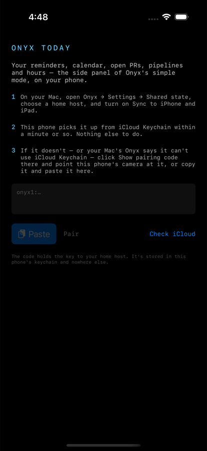
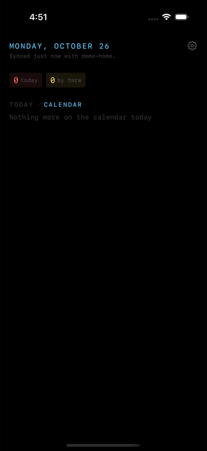

# Onyx Today — building and shipping

Onyx Today is the iPhone app of [the iOS plan](ios-plan.md): the side panel
of simple mode as one scrolling page, with the Timing tiles on top, then the
agenda (reminders or today's calendar), open PRs and tracked pipelines. It
reads and writes the same shared state as the Macs, over its own SSH client.

| Unpaired | Paired and synced (simulator, empty data) |
| --- | --- |
|  |  |

## Where the code is

| Part | What it is |
| --- | --- |
| `Apps/OnyxToday/` | The Xcode project: the `@main` entry point, the icon, Info.plist additions (the `onyx-today://` pairing link), entitlements, and `Version.xcconfig` (kept equal to `OnyxVersion` by `VersionParityTests`). Target `TodayApp`, product "Onyx Today", bundle id `com.onyx.today`. |
| `Sources/OnyxToday` | `TodayModel` (the app's state, and its `SharedStateEnvironment`), `TodayPage`, `PairingView`, `TodaySettingsView`. Builds on macOS too, so `swift build` checks it. |
| `Sources/OnyxUI` | The Today sections, shared with the Mac's simple mode. |
| `Sources/OnyxSSH` | The SSH client (SwiftNIO SSH) and SFTP. |
| `Sources/OnyxCore` | Everything else, including `SharedStateSync`. |

## Building

```
xcodebuild -project Apps/OnyxToday/OnyxToday.xcodeproj -scheme TodayApp \
  -destination 'generic/platform=iOS Simulator' CODE_SIGNING_ALLOWED=NO build
```

CI ("Core for iOS") builds the app and every portable target for iOS on
each push that touches them.

To try it in a simulator against a real server without a phone: the
simulator can't tap "Open" on a pairing link, so a Debug build also reads
a code from the environment —

```
SIMCTL_CHILD_ONYX_TODAY_PAIRING_CODE='onyx1:…' xcrun simctl launch booted com.onyx.today
```

— and the simulator's 127.0.0.1 is the Mac. Grant calendar and reminders
first (`xcrun simctl privacy booted grant calendar com.onyx.today`, and
`reminders`), or the permission prompts sit over the page.

## What shipping needs (not in the repo)

These need an Apple developer account and can't be done from the code:

1. **A team.** Set `DEVELOPMENT_TEAM` on the `TodayApp` target (Signing &
   Capabilities), or pass it to `xcodebuild`. Change the bundle id if
   `com.onyx.today` isn't yours to register.
2. **The keychain group, on both apps.** The iPhone app's entitlements list
   `$(AppIdentifierPrefix)com.onyx.shared` first. For the Onyx key and the
   home host to reach the phone through iCloud Keychain, the **Mac app's**
   entitlements must list the same group first — which on macOS needs a
   provisioning profile embedded in the app. Until then the Mac keeps its
   secrets in a file (`SecretStore` says so, and Settings shows "pair your
   phone with the code"), and the pairing code is how a phone gets them.
3. **TestFlight.** Archive (`Product → Archive`, or `xcodebuild archive`)
   and upload with the team's App Store Connect access.
4. **A device.** Everything above was run in the iOS simulator — pairing
   from a link, signing in with the Onyx key, SFTP and the atomic upload —
   not yet on a phone.
