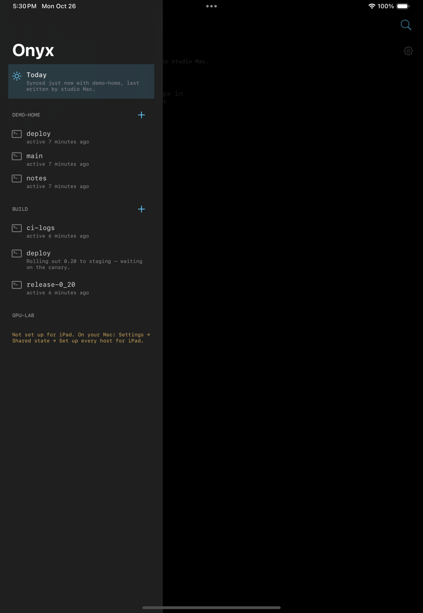
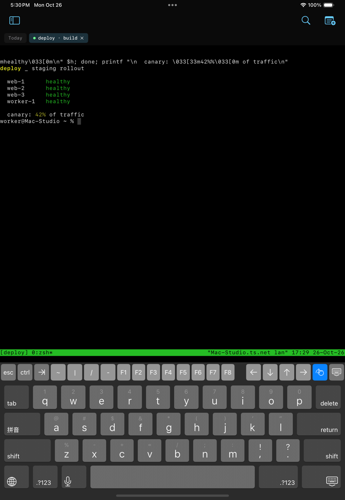
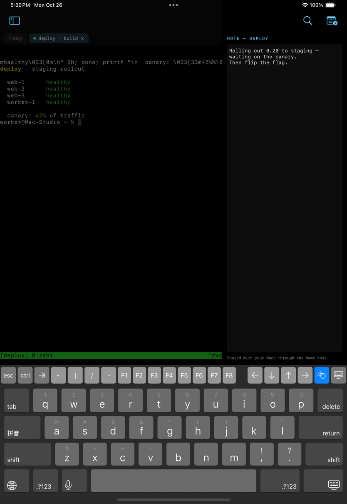

# Onyx Today and Onyx for iPad — building and shipping

One iOS app, two faces ([the iOS plan](ios-plan.md)). On an iPhone it is
**Onyx Today**: the side panel of simple mode as one scrolling page, with
the Timing tiles on top, then the agenda (reminders or today's calendar),
open PRs and tracked pipelines. On an iPad it is **Onyx**: the same Today
page, plus the tmux sessions on every host your Macs share, in real
terminals. Both read and write the same shared state as the Macs, over
their own SSH client.

| Unpaired | Paired and synced (simulator, empty data) |
| --- | --- |
|  |  |

On an iPad (simulator, two demo hosts on this Mac, one not yet set up):

| Sessions on every shared host | A tmux session | With its note |
| --- | --- | --- |
|  |  |  |

## The iPad

- **Hosts** are the ones your Macs publish in the shared state. The iPad
  reaches one only through a *route* — its address, account and host key,
  as a Mac saw them while installing the Onyx key there. On the Mac:
  Settings → Shared state → **Set up every host for iPad** (it appears once
  Sync to iPhone and iPad is on). A host without a route is listed with
  that instruction; paused hosts and hosts behind a ProxyJump are skipped.
- **Sessions** are listed every 20 seconds while the app is in front (pull
  down, or ⌘R, for now). Tap one to attach (`tmux -u new-session -A`), +
  on a host to start one.
- **Keys**: ⌘K go to any session (or name a new one), ⌘0 Today, ⌘W close
  the tab, ⌘⇧] / ⌘⇧[ next and previous tab, ⌘⇧N the session's note, and
  ⌘. for Esc. The on-screen keyboard has Esc, Ctrl, Tab and the arrows.
- **Windows**: each iPad window has its own tabs (Stage Manager, Split
  View); the host list is shared.
- **Notes** are the Macs' session notes, edited beside the terminal.

## Where the code is

| Part | What it is |
| --- | --- |
| `Apps/OnyxToday/` | The Xcode project: the `@main` entry point, the icon, Info.plist additions (the `onyx-today://` pairing link), entitlements, and `Version.xcconfig` (kept equal to `OnyxVersion` by `VersionParityTests`). Target `TodayApp`, product "Onyx Today", bundle id `com.onyx.today`. |
| `Sources/OnyxPad` | The iPad: `PadModel` (hosts, routes, session listings, the palette), `PadTerminal`/`PadWorkspace` (open terminals and tabs, per window), `PadRoot` (the window), `PadTerminalView` (SwiftTerm's UIKit view; the one iOS-only file). |
| `Sources/OnyxToday` | `TodayModel` (the app's state, and its `SharedStateEnvironment`), `TodayPage`, `PairingView`, `TodaySettingsView`. Builds on macOS too, so `swift build` checks it. |
| `Sources/OnyxUI` | The Today sections, shared with the Mac's simple mode. |
| `Sources/OnyxSSH` | The SSH client (SwiftNIO SSH) and SFTP. |
| `Sources/OnyxCore` | Everything else, including `SharedStateSync`. |

## Building

```
xcodebuild -project Apps/OnyxToday/OnyxToday.xcodeproj -scheme TodayApp \
  -destination 'generic/platform=iOS Simulator' CODE_SIGNING_ALLOWED=NO build
```

CI ("Core for iOS") builds the app and every portable target for iOS on
each push that touches them.

To try it in a simulator against a real server without a phone: the
simulator can't tap "Open" on a pairing link, so a Debug build also reads
a code from the environment —

```
SIMCTL_CHILD_ONYX_TODAY_PAIRING_CODE='onyx1:…' xcrun simctl launch booted com.onyx.today
```

— and the simulator's 127.0.0.1 is the Mac. On an iPad simulator,
`SIMCTL_CHILD_ONYX_PAD_OPEN=<host>/<session>` opens that session once it's
listed (add `SIMCTL_CHILD_ONYX_PAD_NOTE=1` for its note). Run the demo sshd
with `SetEnv HOME=… TMUX_TMPDIR=…` so the sessions it shows are its own, not
your account's. Grant calendar and reminders
first (`xcrun simctl privacy booted grant calendar com.onyx.today`, and
`reminders`), or the permission prompts sit over the page.

## What shipping needs (not in the repo)

These need an Apple developer account and can't be done from the code:

1. **A team.** Set `DEVELOPMENT_TEAM` on the `TodayApp` target (Signing &
   Capabilities), or pass it to `xcodebuild`. Change the bundle id if
   `com.onyx.today` isn't yours to register.
2. **The keychain group, on both apps.** The iPhone app's entitlements list
   `$(AppIdentifierPrefix)com.onyx.shared` first. For the Onyx key and the
   home host to reach the phone through iCloud Keychain, the **Mac app's**
   entitlements must list the same group first — which on macOS needs a
   provisioning profile embedded in the app. Until then the Mac keeps its
   secrets in a file (`SecretStore` says so, and Settings shows "pair your
   phone with the code"), and the pairing code is how a phone gets them.
3. **TestFlight.** Archive (`Product → Archive`, or `xcodebuild archive`)
   and upload with the team's App Store Connect access.
4. **A device.** Everything above was run in the iOS simulator — pairing
   from a link, signing in with the Onyx key, SFTP and the atomic upload,
   tmux over the built-in client on the iPad — not yet on a phone or an
   iPad. A hardware keyboard on a real iPad is the part least exercised:
   the simulator can't type into the terminal from a script.
5. **The name.** The product is "Onyx Today" on both; on an iPad it would
   more honestly be "Onyx". That's a `CFBundleDisplayName` per idiom, or two
   App Store listings — a product decision, so it's left as is.
