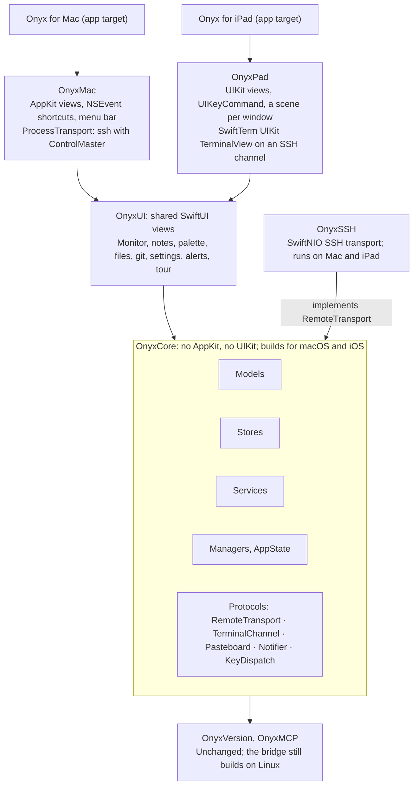
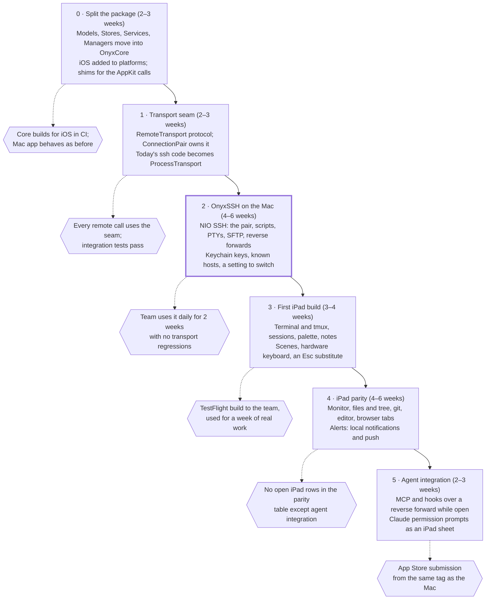

# Onyx for iPad — plan

As of 2026-10-23. Estimates are approximate and assume one engineer working with agents.

## Summary

An iPad Onyx is feasible, and most of the code can be shared, but one piece has to be rebuilt first: how Onyx talks SSH. Every remote feature today launches the system `ssh` binary as a child process. iPadOS has neither the binary nor the ability to launch processes, so the iPad needs an SSH client that runs inside the app.

The recommended path:

1. **Split `OnyxLib` into a platform-neutral core and two thin platform layers**, all in the existing Swift package. Models, Stores and most Services and Managers move to the core; AppKit code stays in a Mac layer; a new iPad layer holds UIKit pieces.
2. **Put a transport protocol between the Managers and SSH.** The Mac keeps its current `ssh` + ControlMaster implementation behind it. An in-process implementation (SwiftNIO SSH) is written once and used by the iPad.
3. **Run the in-process transport on the Mac first, behind a setting.** That way the code the iPad depends on is exercised every day by the people already using Onyx, before an iPad build exists.
4. **Then build the iPad app**: terminal and sessions first, monitor and notes next, files and git after, the agent integration (MCP, hooks, alerts) last.

The work is weighted toward the start: about two thirds of it is restructuring and the transport, which also benefits the Mac. The iPad-specific UI is the smaller part.

## What Onyx is made of today

`OnyxLib` is about 45,600 lines in 149 files. The lower layers are already free of AppKit; the platform code is concentrated in a few places.

| Layer | Files | Lines | Files importing AppKit | What ties it to the Mac |
| --- | --- | --- | --- | --- |
| Models | 28 | 4,089 | 0 | Nothing |
| Stores | 18 | 2,456 | 0 | Nothing |
| Services | 27 | 5,193 | 1 | `Process` in `SSHProcess`, `RemoteExec`, `MCPServer`, `DependencyAnalyzer` |
| Managers | 29 | 13,616 | 9 | `Process` for every remote call; the terminal pool is an `NSView` of `LocalProcessTerminalView`s |
| App | 8 | 4,180 | 6 | `AppDelegate`, `NSEvent` keyboard monitors, the menu bar item, SSH command builders |
| Views | 39 | 16,113 | 12 | 8 `NSViewRepresentable`s; most of the rest is plain SwiftUI |

Three dependencies matter most:

- **The `ssh` binary.** `ConnectionPair` keeps two ControlMaster connections per host, and everything else (stats, git, files, docker, the pane lookup, the MCP installer) runs `ssh` as a mux channel through `Process`. 18 files call the remote-run helpers.
- **The terminal.** `TerminalSessionManager` hosts SwiftTerm's `LocalProcessTerminalView`, which starts `ssh … tmux` as a local child process. SwiftTerm has a UIKit `TerminalView` for iOS, but nothing on iPad can be the local process.
- **Listening sockets.** `MCPServer` listens on a Unix socket and on TCP port 19432, which hosts reach through `ssh -R`. The dashboard server listens too. iPadOS allows listening only while the app is in the foreground.

## The hard problem: SSH on iPadOS

Recommendation: an in-process SSH client built on SwiftNIO SSH, through Citadel for RSA keys and SFTP. It sits behind a transport protocol that the Mac also implements. iPadOS apps can't start processes and there is no `ssh` binary, so the choice is only which library, and how much of OpenSSH's behavior we rebuild.

| Option | Strengths | Weaknesses |
| --- | --- | --- |
| SwiftNIO SSH (Apple) | Pure Swift, async, maintained by Apple; channels, PTYs and `tcpip-forward` | No RSA keys; no SFTP; no `~/.ssh/config` |
| Citadel (on NIO SSH) | Adds RSA, SFTP and a friendlier client API | Smaller project; we'd depend on its maintainers |
| libssh2 via a wrapper | Mature; every key type | C library plus OpenSSL to build for iOS; blocking API to wrap |
| A Mac relays for the iPad | No SSH on the iPad at all | iPad useless away from that Mac; not a real port |
| Mosh | Survives network changes and sleep | Needs `mosh-server` on hosts; terminal only; a later add-on, not a base |

What carries over unchanged:

- **The `ConnectionPair` design.** Two connections per host, a warm standby, a single health authority. ControlMaster only exists to multiplex channels over one connection, and an in-process client does that natively.
- **Everything we learned about remote shells.** An SSH `exec` request still runs `$SHELL -c` on the server, so noexec hosts break it exactly as before. The fix stays the same: a `shell` request with input piped in, and a PTY only as the fallback. The ~1KB terminal input limit, `!` history expansion and zsh's fatal unmatched globs are all properties of the remote side, so `RemoteScript` and its tests stay valid.

What has to be rebuilt:

- **Keys.** There is no `~/.ssh` or agent on the iPad. Generate keys in the Keychain (Secure Enclave keys are ECDSA P-256 only, which most servers accept) or import them; show the public key for `authorized_keys`.
- **Host key checking.** A known-hosts store with the same accept-new behavior we use today.
- **What users keep in `~/.ssh/config`.** Host aliases, `ProxyJump`, per-host user and port. `HostConfig` already holds user, port and identity; jump hosts are the main gap.
- **Networks.** Tailscale works on iPad as a VPN app, so MagicDNS names keep working. iPadOS suspends the app's sockets in the background, so reconnecting on return to the foreground becomes the normal case rather than the recovery case.

## Other platform gaps

Everything other than SSH has an iPadOS equivalent. Two gaps change behavior rather than just code: the app is suspended in the background, and the overlay window has no counterpart.

| Area | Mac today | iPad | Effect |
| --- | --- | --- | --- |
| Terminal | `LocalProcessTerminalView` runs `ssh … tmux` | SwiftTerm's UIKit `TerminalView`, fed by an SSH channel | New glue; terminal rendering is shared |
| Background | Polls, MCP and hooks run all the time | Suspended seconds after leaving the foreground | Polling pauses; tmux keeps sessions alive; reconnect on return |
| MCP server and hooks | Unix socket plus TCP 19432 via `ssh -R` | Reverse forward over our own SSH connection, foreground only | Agents reach the iPad only while it's open; the bridge outbox already queues the rest |
| Alerts | Notification Center, dock bounce, `AlertForwarder` | Local notifications while open; push (ntfy or Pushover) otherwise | `AlertForwarder` is already the off-Mac path |
| Keyboard | `NSEvent` monitors in `KeyboardShortcuts` | `UIKeyCommand` and `pressesBegan` | The shortcut table is shared; dispatch is per platform. iPad Magic Keyboards have no Esc key, which terminals and Claude need |
| Windows | Per-window `AppState`, overlay styling, vibrancy | One `AppState` per `UIScene`; Stage Manager and Split View | No always-on-top overlay; translucency is decorative only |
| Browser tabs and artifacts | `WKWebView` with KVO | `WKWebView` exists on iOS | Mostly shared; the representable is per platform |
| File browser and editor | Remote listing over SSH, `NSOpenPanel`, drag and drop | Same listing over SFTP or exec; document picker; drag and drop | Shared manager, new pickers |
| Pasteboard | `NSPasteboard` | `UIPasteboard`, with iOS's paste prompt | Small shim |
| Calendar and Reminders | EventKit | EventKit | Shared |
| Timing and flowtree | HTTP APIs | Same | Shared |
| Menu bar item | `NSStatusItem` | None | Mac only |
| Dashboard server | HTTP listener for a browser | Foreground only, little use | Mac only |
| Local shell host | `localhost` runs locally | No local shell | Mac only |

## Code-sharing architecture

One Swift package, with `OnyxLib` split by platform rather than copied. The core holds everything that isn't drawing, and each platform layer implements a small set of core protocols. Arrows point at what each part depends on.

The split follows the layers we already have:

- **`OnyxCore`** gets Models, Stores, Services and Managers, plus `AppState` with its platform calls moved behind protocols. `Package.swift` adds `.iOS(.v17)` to its platforms.
- **`RemoteTransport`** is the seam everything remote goes through: run a script (piped, with a TTY fallback), open a terminal channel, transfer a file, open a reverse forward. `ConnectionPair` stays in the core and owns two transport connections per host, whichever implementation they are. `FileBrowserManager.runScriptWithFallback` and the 18 files that call the run helpers move onto it.
- **`ProcessTransport`** is today's code (`SSHProcess`, `RemoteExec`, ControlMaster) moved into `OnyxMac`, unchanged in behavior.
- **`OnyxSSH`** is the new in-process transport. Both apps link it, so the Mac can switch to it with a setting.
- **`OnyxUI`** is the SwiftUI views that don't touch AppKit. Each of the 8 `NSViewRepresentable`s gets a `UIViewRepresentable` twin in `OnyxPad`, behind the same SwiftUI type name.
- **`OnyxMCP` and `OnyxVersion`** don't change. The bridge keeps building on Linux, and the protocol number still decides whether a host's bridge is current.

## Feature parity

Of 21 feature areas, 6 are shared as they stand and 8 more once the transport seam exists; 5 need new iPad UI over shared logic; 2 stay on the Mac. "Shared" means the same Swift files compile into both apps.

| Feature | Sharing | Notes |
| --- | --- | --- |
| Terminal and tmux sessions | Shared logic, new iPad UI | SwiftTerm UIKit view on an SSH channel; tmux attach is the same command |
| Session list, switching, command palette | Shared as is | Palette and fuzzy search are SwiftUI and model code |
| Session notes and favorites | Shared as is | Stores and SwiftUI |
| Shared-state sync (home host) | Shared after the transport seam | Its scp upload-then-mv becomes SFTP, with the same merge |
| Timing and agent hours | Shared as is | HTTP only |
| Calendar and Reminders | Shared as is | EventKit on both |
| Monitor: CPU, GPU, memory, docker, fleet | Shared after the transport seam | Same scripts and parsers; polling pauses in the background |
| Simple-mode layout and bottom strip | Shared logic, new iPad UI | Layout math is shared; iPad needs touch targets and size classes |
| PRs and pipelines (flowtree, GitHub) | Shared after the transport seam | HTTP plus remote git |
| Git status, diff and log | Shared after the transport seam | Same remote scripts |
| File browser, tree and search | Shared after the transport seam | Listing via the transport; SFTP for transfers |
| Browser tabs and artifacts | Shared as is | WKWebView behind a per-platform representable |
| File editor | Shared logic, new iPad UI | `RemoteFileEdit` is shared; the text view is per platform |
| Keyboard shortcuts | Shared logic, new iPad UI | One shortcut table, per-platform dispatch; an Esc substitute |
| Alerts and session alert indicators | Shared after the transport seam | Delivery and routing shared; push when backgrounded |
| MCP tools and Claude hooks | Shared after the transport seam | Foreground only, via a reverse forward over our SSH |
| Claude permission prompts | Shared logic, new iPad UI | Same requests; an iPad sheet instead of the overlay card |
| MCP bridge installer for hosts | Shared after the transport seam | Pushes the bridge over SFTP instead of scp |
| Menu bar item | Mac only | No menu bar on iPad |
| Local shell and localhost host | Mac only | No local processes on iPad |
| Tour, What's New and feature tips | Shared as is | `FeatureCatalog` gains a platform field so tips don't name Mac-only keys |

The LSP (jdtls) and the dependency analyzer already run on the remote host, so they move with the transport. They are part of the file editor row.

## Roadmap

Six phases, roughly 17 to 25 weeks in total. The Mac gets something from each of the first three: a cleaner structure, a testable transport and an SSH client that doesn't need the `ssh` binary. The risky transport runs on the Mac before the iPad depends on it.

Phases 0 and 1 are pure refactors on master, landed in small PRs, with no change in behavior. Phase 2 is the riskiest, which is why it ships to Mac users first: problems with the new transport surface where we can still switch back to `ProcessTransport`. The iPad work starts only when the transport has passed that gate, so iPad bugs are UI bugs rather than SSH bugs.

## Keeping parity over time

Parity holds if diverging is harder than sharing: the core must build for both platforms on every commit, and platform code must stay small enough to review. The rules below would go into CLAUDE.md, where agents working on Onyx will follow them.

1. **CI builds `OnyxCore` for macOS and iOS on every push**, plus both apps. An AppKit import in the core fails the iOS build, so the boundary is enforced by the compiler rather than by review.
2. **The core test suite runs on both platforms.** Today's 1,470 tests mostly cover Models, Services and Managers, so they move with the code. The iOS run uses the simulator.
3. **New features start in the core.** A feature PR adds its model, store and manager to `OnyxCore` and its view to the shared SwiftUI views when it can. Platform code is limited to what the platform forces, such as an `NSViewRepresentable`/`UIViewRepresentable` pair.
4. **A parity line in every feature PR.** The PR says "iPad: same / follow-up #n / Mac only, because …". `FeatureCatalog` gets a `platforms` field, and a test fails when a feature has no answer for the iPad.
5. **Platform shims live in one folder per platform** (`Platform/Mac`, `Platform/Pad`), each conforming to a core protocol. A new `#if os(macOS)` inside the core needs a reason in its comment, and a lint script counts them so growth is visible.
6. **The transport is tested against real hosts on both implementations.** The integration tests that exercise SSH run against the `Process` transport and the NIO transport, so behavior can't drift between them.
7. **One version number for both apps.** Like `OnyxVersion`: the iPad app ships from the same tag, and release notes have one list with iPad differences noted inline.

## Risks and open questions

The biggest risk is the transport: it replaces OpenSSH, which has years of hard-won behavior that Onyx relies on without seeing it.

| Risk | Why it matters | Mitigation |
| --- | --- | --- |
| The NIO transport behaves differently from OpenSSH | `ConnectionPair` invariants and the remote-shell lessons in CLAUDE.md were all learned against OpenSSH | Run it on the Mac first, behind a setting, for weeks before the iPad depends on it |
| Key types and auth methods | NIO SSH has no RSA; users may have RSA keys, keyboard-interactive auth or 2FA | Citadel for RSA; on-device ECDSA keys as the default |
| Jump hosts and `~/.ssh/config` habits | Users reach some hosts only through `ProxyJump` | Model jump hosts in `HostConfig`; import an ssh config on the Mac and sync it |
| Agents can't reach a suspended iPad | MCP and hooks only work while Onyx is open | The bridge already queues alerts in its outbox; push for urgent ones |
| Hooks stall when the iPad is the only desktop | A hook that can't reach Onyx must fail fast | The 3-second watchdog and back-off already cover this |
| App Store review | Terminal and SSH apps are allowed, but an MCP listener may draw questions | Start with TestFlight; describe the listener as user-initiated |
| The restructuring slows Mac work | A long-lived branch would collide with daily features | Move layers in small PRs on master, never a long branch |

Open questions:

- [ ] Is the Mac meant to move to the in-process SSH eventually, or keep OpenSSH for good? The plan assumes the former.
- [ ] Which iPadOS version is the minimum? iPadOS 17 matches macOS 14's SwiftUI.
- [ ] Should the iPad support iPhone too? The same target can, but the layout work isn't in this plan.
- [ ] Citadel, or NIO SSH plus our own RSA and SFTP? This decides how many dependencies we add.
- [ ] Is foreground-only MCP enough, or do people need the iPad as a desktop agents can always reach?
- [ ] How are keys and host configs moved from the Mac: shared state on the home host, iCloud Keychain, or manual import?
